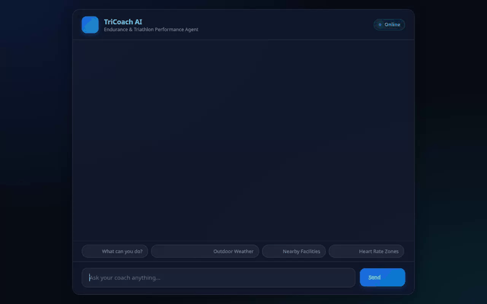

# TriCoach AI — Personal Fitness & Triathlon AI Agent

TriCoach AI is an intelligent personal fitness and endurance coaching agent powered by Google ADK (Agent Development Kit) and Gemini. It provides personalized training advice, logs workout history to Firestore, computes training stress and heart rate zones, locates training facilities, remembers athlete dietary preferences and restrictions across sessions via Vertex AI Memory Bank, and generates short workout videos using Google's Gemini Omni model.



---

## 🌟 Capabilities & Features (Implemented in Code)

### 🧠 Persistent Long-Term Memory (Vertex AI Memory Bank)
- **Automatic Memory Recall**: Remembers user allergies, health conditions, target race dates, and dietary preferences across conversations.
- **Preload Memory Tool**: Automatically loads recalled user facts before generating responses.

### 📊 Workout Logging & Database Lookups (Google Cloud Firestore)
- **Log Workouts**: Persists workouts (running, cycling, swimming) with distance, duration, perceived effort, and notes into Cloud Firestore.
- **Workout History**: Queries recent workouts from Firestore to analyze consistency and training progress.

### 🎬 Workout Video Generation (Gemini Omni & Google Cloud Storage)
- **Video Generation**: Generates 2-second training demonstration videos using `gemini-omni-flash-preview` in the `global` Vertex AI region.
- **Cloud Storage Integration**: Automatically uploads generated videos to Google Cloud Storage (`gs://qwiklabs-gcp-03-89266242dbeb-static-assets-bucket`) and returns public HTTPS playback URLs.
- **Playground Artifacts**: Registers video files in ADK `ToolContext` for display in the Playground's Artifacts panel.

### 🧮 Training Stress & Zone Calculators (Python Sandbox / Code Execution)
- **Heart Rate & Training Zones**: Calculates 5-zone HR models based on resting and max heart rate.
- **Power Zones (FTP)**: Calculates 7 Coggan power zones from Functional Threshold Power (FTP).
- **TSS & Recovery Score**: Computes Training Stress Score (TSS) and estimates recovery time.

### 🌦️ Weather & Geolocation Services
- **Outdoor Training Weather**: Fetches real-time temperature, wind speed, and precipitation.
- **Geocoding & Nearby Facilities**: Converts addresses to coordinates and locates nearby pools, gyms, running tracks, and parks.

### 🎨 Agent-to-User Interface (A2UI)
- **Rich Structured UI**: Emits structured A2UI cards for workout summaries, training plans, and facility listings rendered dynamically in the web UI.

---

## 🏗️ Google Cloud Services & Technologies Used

- **Google Agent Development Kit (ADK)**: Core agent framework (`google-adk`).
- **Gemini 2.5 Flash**: Primary conversational LLM (`gemini-2.5-flash`).
- **Gemini Omni Flash**: Short video generation (`gemini-omni-flash-preview` via Vertex AI Interactions API).
- **Vertex AI Memory Bank Service**: Managed long-term session memory.
- **Google Cloud Firestore**: NoSQL database for workout logging and athlete profiles.
- **Google Cloud Storage (GCS)**: Asset hosting bucket for generated videos.
- **FastAPI & A2A Protocol**: Lightweight web app and Agent-to-Agent protocol server.

---

## 📋 Planned / Not Yet Implemented

The following features were outlined in initial design concepts but are not yet implemented in the codebase:
- *Image Generation*: Currently replaced by Gemini Omni video generation.
- *Pub/Sub Automated Workout Reminders*: Planned for future background notification integration.

---

## 🛠️ Local Setup & Run Instructions

### Prerequisites
- Python 3.11+
- `uv` package manager installed (`pip install uv`)
- Google Cloud authentication configured (`gcloud auth application-default login`)

### Installation & Environment Setup

1. **Clone and enter the directory**:
   ```bash
   cd tricoach-ai
   ```

2. **Install dependencies**:
   ```bash
   uv sync
   ```

3. **Configure Environment Variables**:
   Set your GCP project in `.env`:
   ```bash
   GOOGLE_CLOUD_PROJECT="qwiklabs-gcp-03-89266242dbeb"
   GOOGLE_CLOUD_REGION="us-east1"
   ```

### Running the Application

1. **Start the Frontend & Agent Proxy Server**:
   ```bash
   AGENT_ENGINE_RESOURCE_NAME="projects/636738179253/locations/us-east1/reasoningEngines/7653997309088235520" AGENT_DIRECTORY="app" PORT=8080 python frontend/main.py
   ```

2. **Open in Browser**:
   Navigate in your web browser to `localhost:8080`.

3. **Run Interactive Demo Script**:
   To execute the automated Playwright demo recorder:
   ```bash
   python record_demo.py
   ```
